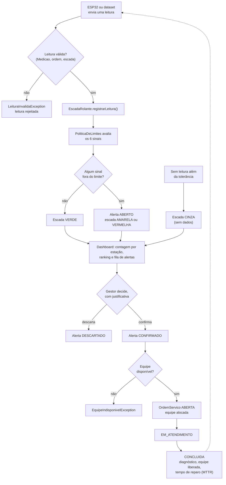
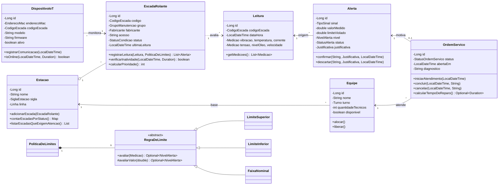

# Monitoramento de Escadas Rolantes — Challenge FIAP + Motiva 2026

Sprint 1/2 de **Domain Driven Design (Java)** e **Database Design**.

## Integrantes

| Nome | RM |
|---|---|
|Alexandre Constantino Furtado Junior| RM567188 |
| Leonardo Batista de Souza | RM568558 |
| Matheus Freitas dos Santos | RM567337 |
| Nicolas Forcione | RM66998 |

## Objetivo

A Motiva mantém 197 escadas rolantes na ViaQuatro (Linha 4-Amarela) com manutenção preventiva **por calendário**, sem enxergar a condição real de cada equipamento. Isso consome a maior parte do orçamento, mesmo em escadas sem sinal de falha, e faz a equipe descobrir problemas só quando a escada já parou.

Este projeto modela o domínio de uma plataforma de **monitoramento de condição multimarca**:

1. recebe as leituras dos sensores de cada escada (vibração, temperatura, corrente, tensão, nível de óleo e velocidade), enviadas por um ESP32 ou vindas do dataset da Motiva;
2. compara cada sinal com limites explicáveis e classifica a escada em verde, amarelo, vermelho ou cinza (sem dados);
3. gera alertas com a evidência (valor medido e limite ultrapassado) e ordena as escadas por prioridade;
4. **recomenda**, mas não decide: só o gestor confirma ou descarta um alerta, sempre com justificativa;
5. com o alerta confirmado, abre uma ordem de serviço e aciona uma equipe disponível, que registra o diagnóstico ao concluir.

O sistema nunca comanda a escada (não liga, não desliga, não altera velocidade) e não substitui as inspeções e preventivas obrigatórias.

## Como funciona — fluxo lógico (System Design)

O mesmo fluxo está contado em forma de **storyboard comentado** na classe driver [`Main.java`](src/main/java/br/com/fiap/motiva/escadas/Main.java), cena por cena.



Uma ordem de serviço para um alerta que **não** foi confirmado é bloqueada com `AcionamentoNaoAutorizadoException` (regra RN02: nenhuma equipe é acionada sem aprovação do gestor).

## Modelo de domínio



## Onde está cada critério da avaliação

| Critério | Onde encontrar |
|---|---|
| Fluxo lógico (fluxograma **e** storyboard) | Fluxograma acima; storyboard comentado em `Main.java` (cenas 1 a 11) |
| Entidades do domínio com atributos e comportamentos | `dominio/entidade`: `Estacao`, `EscadaRolante`, `DispositivoIoT`, `Leitura`, `Alerta`, `OrdemServico`, `Equipe` |
| Modificadores de acesso (encapsulamento) | Todos os atributos são `private`; identidades e códigos são `final`; listas são expostas somente leitura |
| Construtores para usos distintos | Cada entidade tem um construtor de **cadastro** (objeto novo, sem id) e um de **reconstrução** (com id, como virá do banco). `CodigoEscada` aceita o texto pronto ou sigla + número |
| Apenas os acessores e mutadores necessários | Não há setters de id, código ou status: o status muda só por comportamentos (`registrarLeitura`, `confirmar`, `concluir`...). Os dois setters existentes têm motivo de negócio e validação: `Equipe.setQuantidadeTecnicos` e `DispositivoIoT.setFirmware` |
| `toString()` sobrescrito | Em todas as entidades, VOs, regras e enums de exibição |
| Classes driver de teste isolado | Pacote `teste`: um driver por classe (`TesteEscadaRolante`, `TesteAlerta`...) e `ExecutarTodosOsTestes` |
| Enumerações para campos fixos | `dominio/enums`: `Linha`, `GrupoManutencao`, `StatusCondicao`, `NivelAlerta`, `StatusAlerta`, `StatusOrdemServico`, `TipoSinal`, `Turno`, `Fabricante` |
| Classes de exceção | `dominio/excecao`: base `DominioException` e 5 específicas |
| Value Objects com validações | `dominio/vo`: `CodigoEscada`, `SiglaEstacao`, `Medicao`, `EnderecoMac`, `Justificativa`. As regras em `dominio/regra` também são imutáveis e validadas |

Os quatro pilares de POO aparecem em: **abstração** (`RegraDeLimite`), **encapsulamento** (atributos privados e status alterado só por comportamento), **herança** (`LimiteSuperior`, `LimiteInferior`, `FaixaNominal`; hierarquia de exceções) e **polimorfismo** (`avaliarValor` responde de forma diferente em cada regra; veja `TesteRegrasDeLimite`).

## Estrutura

```
src/main/java/br/com/fiap/motiva/escadas/
├── Main.java                 driver principal (storyboard)
├── dominio/
│   ├── entidade/             7 entidades
│   ├── enums/                9 enumerações
│   ├── vo/                   5 Value Objects
│   ├── regra/                regras de limite (abstração + polimorfismo)
│   └── excecao/              6 exceções de domínio
└── teste/                    drivers de teste isolados
```

## Como executar

Requer **Java 17 ou superior**. Não há dependências externas.

**IntelliJ / Eclipse / VS Code:** abra a pasta do projeto (é um projeto Maven) e rode:
- `Main` para ver o storyboard completo;
- `teste/ExecutarTodosOsTestes` para rodar todos os testes (ou qualquer `Teste*` sozinho).

**Terminal, sem Maven:**

```bash
javac -encoding UTF-8 -d out $(find src -name "*.java")
java -cp out br.com.fiap.motiva.escadas.Main
java -cp out br.com.fiap.motiva.escadas.teste.ExecutarTodosOsTestes
```

No Windows, se os acentos aparecerem trocados no terminal, rode `chcp 65001` antes.

Resultado esperado dos testes: 9 conjuntos, 138 verificações.

## Observações

- **Dados fictícios.** Estações, códigos, MACs e leituras usados no storyboard e nos testes são exemplos.
- **Limites provisórios.** Os valores em `PoliticaDeLimites.provisoria()` e as faixas físicas em `TipoSinal` não são norma técnica nem dado da Motiva: serão substituídos pelos valores encontrados na análise exploratória do dataset (Data Science).
- **Integração com Database Design.** As entidades correspondem às tabelas do modelo relacional (`ESTACAO`, `ESCADA_ROLANTE`, `DISPOSITIVO_IOT`, `LEITURA`, `ALERTA`, `EQUIPE`, `ORDEM_SERVICO`); o script está em [`database/`](database/).
- **Próximas sprints.** DTOs, Controllers, Services e a integração com o banco (JDBC) ainda não fazem parte desta entrega, conforme a avaliação. A hierarquia `DominioException` já foi pensada para ser tratada em um único ponto pela camada de Controller.
